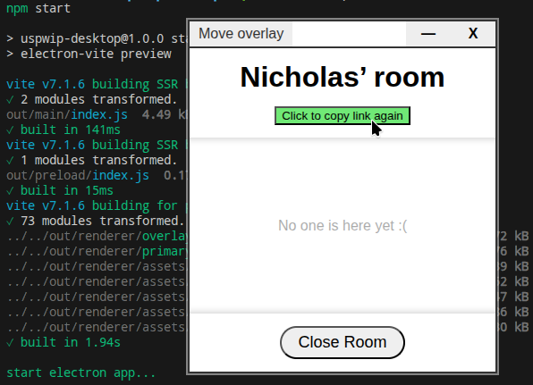

# USPWIP Desktop README


*See https://github.com/nicholasubc/usp-wip-web for web client*

### Install

```bash
$ npm install
```

### Development

```bash
$ npm run dev
```

### Build

```bash
# For windows
$ npm run build:win

# For macOS
# soon(tm)

# For Linux
$ npm run build:linux
```
